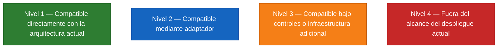

# AudacIA — Alcance, Límites y Compatibilidad del Ecosistema de Agentes

**Definición de la Plataforma:**
> "AudacIA es una plataforma general de integración de agentes. Puede incorporar una amplia variedad de agentes, pero la admisión concreta de cada agente depende de sus requisitos de recursos, modalidad de procesamiento, duración, aislamiento, interfaces, efectos secundarios, seguridad y políticas de ejecución."

AudacIA no se concibe como un sistema sin restricciones capaz de albergar cualquier agente imaginable sin importar su coste computacional, ni como una arquitectura cerrada limitada únicamente a los agentes existentes. Es una plataforma extensible gobernada por contratos explícitos, barreras de autorización deterministas y presupuestos de hardware rigurosos.

---

## 1. Arquitectura Definitiva del Servidor Central

El despliegue de AudacIA opera bajo una topología de **servidor físico central único**:

- **Servidor Físico Central:**
  - **GPU:** NVIDIA GeForce RTX 5070 Ti (16 GB VRAM GDDR7).
  - **Memoria RAM:** 32 GB RAM DDR5.
  - **Sistema Operativo:** Windows 11 Pro con privilegios administrativos locales sobre el host.
  - **Servicios Centrales en el Host:** Servidor de inferencia LLM (`llama-server.exe`), aplicación web y WebSocket Django/ASGI (Uvicorn), base de datos (PostgreSQL/SQLite), servicios de audio (Whisper STT, Piper TTS), agentes integrados, HACU Visitante y HAKU Inventario.
- **Topología de Red y Clientes:**
  - Los teléfonos móviles, laptops y computadores de escritorio son **únicamente clientes remotos**.
  - Los clientes acceden al servidor a través de la red Wi-Fi institucional existente (`unisimon.edu.co`), mediante la dirección IP local del servidor (`172.16.130.73`) o URL/nombre de host en el puerto seguro HTTPS 8766.
  - **Restricciones de Red Inamovibles:** No se dispone de acceso administrativo al router Wi-Fi, no se modificará su configuración y no se abrirán puertos WAN hacia Internet.
- **Objetivo Operativo de Concurrencia:**
  - El sistema tiene como objetivo soportar aproximadamente **diez usuarios concurrentes**, pudiendo varios usuarios realizar consultas simultáneas al mismo agente o a agentes diferentes.

---

## 2. Diferenciación Epistemológica de Afirmaciones Técnicas

Para mantener la máxima integridad de ingeniería, toda afirmación en este documento se adscribe a una de cuatro categorías:

1. **Evidencia Empírica Comprobada:** Hecho medido y verificado directamente en el repositorio mediante pruebas automatizadas o diagnósticos de red ejecutados (ej. pruebas de resiliencia del orquestador, captura de audio bajo contexto HTTPS en puerto 8766, consumo de memoria de 50 contextos en Django por ~338 KB).
2. **Inferencia Técnica Fundamentada:** Deducción de ingeniería derivada de especificaciones conocidas y verificadas (ej. modelo Llama 3.1 8B cuantizado Q4_K_M ocupa ~4.7 GB de VRAM; con 16 GB de VRAM en la RTX 5070 Ti quedan más de 9 GB libres para ranuras paralelas o servicios auxiliares).
3. **Arquitectura Propuesta / Implementada en Software:** Mecanismos de software diseñados y programados en el repositorio (ej. [`OrquestadorAudacIA`](file:///C:/Users/AudacIA/Documents/inventario/voz-rag-universidad/cerebro_audacia/agentes/orquestador.py), gobernadores de cola FIFO, triple barrera de seguridad, poda dinámica de herramientas).
4. **Requisito Pendiente de Validación Física:** Metas de rendimiento que requieren la ejecución de benchmarks sobre el servidor físico final una vez ensamblado (ej. latencias P50/P95/P99 del LLM bajo carga de 10 usuarios concurrentes reales en GPU, comportamiento térmico y doble fase de tool calling en ráfaga).

---

## 3. La Definición del Límite Real de AudacIA

El límite de AudacIA no es una etiqueta arbitraria sobre "qué tipo de agente es" (si el agente habla, analiza texto, consulta bases de datos o clasifica imágenes).

El límite real de admisión se define por la siguiente condición:
> **"Un agente es admisible en AudacIA si y solo si sus requisitos operativos pueden satisfacerse de forma segura, aislada, auditable y sostenible con los recursos de hardware, infraestructura de red y políticas de ejecución del servidor central."**

Esta condición evalúa siete dimensiones:
1. **Presupuesto de Recursos:** Si el consumo de VRAM, RAM, CPU o E/S cabe en los márgenes disponibles sin degradar al modelo central compartido ni agotar la memoria.
2. **Modalidad y Duración:** Si el agente puede responder en el ciclo síncrono del orquestador (< 5 a 10 s) o si requiere infraestructura asíncrona de colas y trabajadores en segundo plano.
3. **Aislamiento de Estado y Sesión:** Si garantiza que sus variables, historiales y memoria operacional no contaminen las sesiones de otros usuarios o agentes concurrentes.
4. **Efectos Secundarios y Mutaciones:** Si las escrituras o cambios de estado están protegidos por control transaccional, idempotencia y confirmación humana en dos pasos.
5. **Seguridad y Autorización:** Si la identidad proviene de la sesión verificada, los parámetros se validan contra esquemas rígidos y el acceso a recursos específicos (ej. almacén) está autorizado externamente.
6. **Interfaces de Integración:** Si implementa [`AgentContract`](file:///C:/Users/AudacIA/Documents/inventario/voz-rag-universidad/cerebro_audacia/agentes/contrato.py#L38) o dispone de un adaptador que normalice su interacción.
7. **Políticas Institucionales:** Si respeta el principio de procesamiento local predeterminado y la protección de datos universitarios.

---

## 4. Los Cuatro Niveles Formales de Compatibilidad

### Nivel 1 — Compatible directamente con la arquitectura actual
Agentes diseñados nativamente para el ecosistema, que implementan [`AgentContract`](file:///C:/Users/AudacIA/Documents/inventario/voz-rag-universidad/cerebro_audacia/agentes/contrato.py#L38), responden en el ciclo síncrono interactivo (< 5 s), no compiten por VRAM adicional y operan dentro del modelo de seguridad existente (ej. [`AgenteAuditoriaStock`](file:///C:/Users/AudacIA/Documents/inventario/voz-rag-universidad/cerebro_audacia/agentes/auditoria.py#L22), consultas de catálogo y ubicaciones).

### Nivel 2 — Compatible mediante adaptador
Agentes o subsistemas funcionales existentes en el proyecto que poseen lógica de negocio probada pero no fueron concebidos con la interfaz `AgentContract` (ej. normalizador determinista de HAKU Inventario, motor RAG de HACU Visitante). Son plenamente viables en el hardware actual y se integran mediante **Adaptadores de Contrato** sin modificar su código interno ni alterar sus contratos vigentes.

### Nivel 3 — Compatible bajo controles o infraestructura adicional
Capacidades técnicamente viables en el servidor central (RTX 5070 Ti de 16 GB y 32 GB RAM) pero que requieren componentes de soporte o salvaguardas especiales para no desestabilizar la plataforma:
- **Tareas Largas:** Requieren trabajadores en segundo plano (workers asíncronos/colas) desacoplados del bucle síncrono HTTP.
- **Modelos Secundarios Compactos (OCR / Visión / Audio Mediano):** Viables si y solo si su consumo de VRAM/RAM cabe en el presupuesto libre (~9 GB VRAM, ~20 GB RAM) sin competir destructivamente con el LLM central.
- **APIs Externas de Internet:** Viables únicamente bajo autorización explícita, lista blanca de dominios, timeouts estrictos y control de salida de datos (*egress*).

### Nivel 4 — Fuera del alcance del despliegue actual
Agentes o capacidades que **no pueden garantizarse en el despliegue físico actual** del servidor central:
- Modelos fundacionales gigantes o multimodales pesados (> 10-12 GB VRAM) que no caben junto al LLM de 8B cuantizado y su KV cache.
- Agentes que vulneran las prohibiciones absolutas de seguridad de AudacIA.
- *Nota Clarificadora:* "Nivel 4" no significa que AudacIA conceptualmente jamás pueda admitirlos; significa que **este despliegue físico específico (RTX 5070 Ti 16 GB, host único local) no puede asegurarlos sin comprometer su estabilidad**.

---

## 5. Criterios Específicos de Integración y Aclaraciones Técnicas

### 5.1. Visión, Imagen y OCR
- **Ajuste por Hardware de 16 GB:** Con la RTX 5070 Ti y 32 GB de RAM, se elimina la prohibición heredada del entorno previo de 8 GB.
- **OCR (Reconocimiento Óptico de Caracteres):** Soluciones como Tesseract OCR o PaddleOCR ejecutadas sobre CPU y RAM consumen ~500 MB de memoria de sistema y 0 MB de VRAM. Son clasificadas como **Nivel 3** (requieren conector en segundo plano o aislamiento de CPU para no retrasar la API web).
- **Modelos de Visión / Multimodales (VLM):**
  - Modelos ultracompactos (ej. Moondream2 de 1.8B o MiniCPM-V 2.6 cuantizado, ocupando ~2.5 a 4.0 GB VRAM): Son clasificados como **Nivel 3** bajo evaluación de presupuesto de VRAM, requiriendo validación en benchmark para certificar que coexisten con las 2 ranuras del LLM central.
  - Modelos multimodales medianos/grandes (ej. LLaVA-1.6-34B o modelos de 11B+ en precisión FP16): Son clasificados como **Nivel 4** en el despliegue actual, al sobrepasar la capacidad de 16 GB de VRAM.
  - *No se afirma que cualquier modelo multimodal sea ejecutable.* La admisión depende estrictamente del consumo medido frente a la VRAM disponible.

### 5.2. Conectividad a Internet y Servicios Externos
Es imprescindible distinguir tres conceptos:
1. **Conectividad de Red del Servidor:** El host físico tiene acceso a la red universitaria y salida a Internet a través de ella.
2. **Acceso de los Clientes al Servidor:** Los dispositivos de los usuarios acceden al servidor a través de la Wi-Fi local mediante la IP privada institucional. El funcionamiento estándar de AudacIA es **100% local** y no requiere conexión a Internet para operar.
3. **Capacidad de los Agentes para Consumir Servicios Externos:**
   - **Por defecto: Prohibido.** Los agentes no poseen acceso libre ni arbitrario a sockets externos.
   - **Excepciones de Nivel 3:** Una eventual API externa (ej. consulta del clima local o validación de catálogos universitarios públicos) debe ser una dependencia explícitamente autorizada en la política del proyecto, con allowlist de URLs/IPs, timeout rígido (< 3.0 s), disyuntor (*circuit breaker*) y validación de datos para evitar la fuga de información interna.

### 5.3. Concurrencia de 10 Usuarios: Separación de Capacidades y Benchmark Físico
No se debe presentar como hecho probado que diez usuarios pueden realizar inferencia simultánea sobre el LLM con latencias P50/P95 fijas. Las pruebas ejecutadas hasta la fecha sobre el orquestador validaron la lógica de colas, despacho, barreras de seguridad y aislamiento de memoria utilizando respuestas sintetizadas (mocks).

La capacidad de 10 usuarios se analiza en cuatro niveles diferenciados:
1. **Capacidad de Red (Capa ASGI / Uvicorn):** Comprobada. Puede sostener decenas de conexiones TCP/WebSocket abiertas consumiendo < 5 MB de RAM.
2. **Capacidad del Orquestador:** Comprobada en software. Encola solicitudes, aplica límites FIFO, aísla sesiones y valida esquemas en milisegundos.
3. **Capacidad de Agentes Deterministas:** Comprobada. Consultas a base de datos local y cálculos de stock tardan < 15 ms en CPU, permitiendo atención concurrente inmediata sin tocar la GPU.
4. **Capacidad de Inferencia Real del LLM en GPU:** **Requisito pendiente de validación física**. La inferencia es el único cuello de botella que compite por VRAM y núcleos Tensor.

#### Protocolo Obligatorio del Benchmark Físico (RTX 5070 Ti Final)
El benchmark de aceptación sobre el hardware final medirá obligatoriamente:
- **Latencias:** P50, P95 y P99 de latencia de extremo a extremo.
- **TTFT (Time-To-First-Token):** Tiempo hasta la emisión del primer token en streaming.
- **Duración Total y Rendimiento:** Tiempo total de generación y tokens por segundo agregados e individuales.
- **Memoria:** Consumo basal, pico y residual de VRAM en la GPU y RAM física en el sistema.
- **Carga de Hardware:** Porcentaje de utilización de la GPU, núcleos de CPU y bus PCIe.
- **Comportamiento Térmico:** Curva de temperatura de la GPU (°C) para garantizar que no ocurra *thermal throttling* (umbral preventivo: 83°C).
- **Dinámica de Colas:** Longitud máxima de cola observada, tiempos de espera en cola y rechazos por saturación (`QUEUE_SATURATED`).
- **Resiliencia:** Conteo de errores HTTP, desconexiones tempranas de clientes y timeouts.
- **Herramientas y Concurrencia Real:** Ejecución de llamadas a herramientas bajo ranuras concurrentes (`--parallel 2`), midiendo el comportamiento de la **doble fase de tool calling** (fase 1: LLM propone herramienta $\rightarrow$ orquestador ejecuta $\rightarrow$ fase 2: LLM sintetiza respuesta).

### 5.4. Herramientas y Tool Calling: Separación de Propuesta y Autorización
- El modelo LLM es un componente de razonamiento lingüístico: **únicamente propone** una llamada a función basada en la intención del usuario.
- **La autorización es estrictamente determinista y externa al modelo.** El orquestador ejecuta una validación secuencial antes de despachar cualquier acción:
  1. *Herramienta Permitida:* La herramienta figura en el catálogo activo para el tipo de sesión.
  2. *Canal Autorizado:* El canal de entrada (`web_lan`, `consola`, etc.) está explícitamente habilitado en `metadata.canales_permitidos`.
  3. *Esquema Estricto:* Los argumentos generados por el LLM se validan sintáctica y semánticamente contra el JSON Schema de la herramienta.
  4. *Identidad Inyectada:* El identificador de usuario (`usuario_id`) se extrae de la sesión web autenticada; se rechaza cualquier identidad enviada en los argumentos del LLM.
  5. *Permisos de Rol:* Se comprueba que el usuario posea los roles requeridos para la capacidad.
  6. *Autorización de Recurso Concreto (Anti-BOLA/IDOR):* Si la herramienta opera sobre un recurso específico (ej. `almacen_id`), se valida que el usuario tenga acceso asignado a ese almacén.
  7. *Límites de Recursos:* El ejecutor verifica que el `ResourceProfile` (timeout, límites de concurrencia) no esté saturado.
  8. *Política de Mutación:* Las acciones destructivas o de alteración de estado no se ejecutan directamente; se emiten como propuestas sujetas a confirmación humana posterior.

### 5.5. Utilidades Cognitivas Auxiliares No-LLM y Prohibición de LLMs por Agente
- **Regla Innegociable de Lenguaje:** En AudacIA existe un **único proveedor de lenguaje (Cerebro Central)**. Ningún agente puede cargar un LLM secundario ni administrar un modelo de texto independiente.
- **Utilidades Auxiliares No-LLM (Embeddings locales, OCR, Audio):** Si una tarea especializada requiere un componente de procesamiento no-LLM (ej. modelo de embeddings para RAG o OCR en CPU):
  - Modelos en CPU/RAM (ej. Tesseract OCR o embeddings compactos con `< 500` MB RAM) se admiten en **Nivel 3** bajo `ResourceProfile`.
  - Cualquier intento de cargar un modelo de lenguaje adicional (LLM) que compita por VRAM con el Cerebro Central se clasifica como **Nivel 4 (TERMINANTEMENTE PROHIBIDO)**.

### 5.6. Tareas Largas y Procesamiento Batch
Las tareas largas (ej. reindexación completa de documentos RAG, auditorías forenses de todo el histórico de inventario o generación de reportes masivos) **no son incompatibles con la arquitectura de AudacIA**, pero **no pueden ejecutarse dentro del ciclo síncrono del orquestador**.
- Ejecutarlas en la solicitud HTTP agotaría el timeout del cliente (30 s) y bloquearía los hilos del servidor.
- Su admisión en **Nivel 3** exige infraestructura de trabajos en segundo plano (workers asíncronos o procesos desacoplados con colas en memoria o base de datos), donde el agente responde inmediatamente con un identificador de tarea (`task_id`) y el cliente consulta el progreso de manera no bloqueante.

---

## 6. Matriz Exhaustiva de Admisión de Agentes

A continuación se evalúa la política de admisión para diecinueve familias de capacidades en el servidor central definitivo (RTX 5070 Ti 16 GB, 32 GB RAM, host único local):

| Familia de Agente | Nivel Formal | Requisitos Operativos | Principal Riesgo | Condición de Admisión |
| :--- | :---: | :--- | :--- | :--- |
| **1. Deterministas (Cálculos / Reglas)** | **Nivel 1** | CPU estándar, ejecución en < 10 ms. Implementación de `AgentContract`. | Ninguno relevante en recursos; posible error en reglas fijas. | Respuestas inmediatas sin pasar por inferencia LLM para lógica algorítmica. |
| **2. ORM / Base de Datos** | **Nivel 1** | Acceso a PostgreSQL/SQLite mediante Django ORM con filtros por usuario. | Inyección indirecta, consultas N+1 lentas. | Consultas estrictamente acotadas por `usuario_id` y transacciones de solo lectura por defecto. |
| **3. Analíticos de Inventario** | **Nivel 1** | CPU/RAM para agregaciones numéricas de existencias y movimientos. | Consumo excesivo de RAM si no se pagina la consulta. | Consultas con agregaciones SQL nativas (`Sum`, `Count`) y límite de registros. |
| **4. RAG Documental (HACU)** | **Nivel 2** | Índice FAISS o SQLite FTS, embeddings y ranura en LLM central. | Alucinación sobre el corpus, desborde de ventana de contexto. | Integración mediante `HacuVisitanteAdapter`; consumo exclusivo del Cerebro Central. |
| **5. Procesamiento de Documentos** | **Nivel 3** | Bibliotecas CPU (`pypdf`, `python-docx`) y memoria RAM suficiente. | Congelamiento del hilo de red ante archivos pesados (> 50 MB). | Ejecución con límite de tamaño de archivo (< 10 MB) y timeout de CPU (< 5 s). |
| **6. OCR (Digitalización)** | **Nivel 3** | Tesseract OCR o PaddleOCR en CPU/RAM (~500 MB RAM, 0 VRAM). | Sobrecarga de núcleos de CPU durante ráfagas de usuarios. | Encolamiento con `ResourceProfile(max_concurrencia=1)` y timeout de 10 s. |
| **7. Procesamiento de Imagen Básico** | **Nivel 3** | Biblioteca Pillow/OpenCV en CPU para redimensionar o extraer metadatos. | Archivos corruptos o bombas de descompresión (*decompression bombs*). | Validación estricta de cabeceras, límites de resolución (ej. máx. 4K) y saneamiento. |
| **8. Visión / Multimodal (VLM)** | **Nivel 3 / Nivel 4** | GPU VRAM. Si el VLM es compacto ($\le 3.5\text{ GB}$ VRAM) es N3; si es $> 4\text{ GB}$ es N4. | Saturación de VRAM, OOM en GPU y colapso de `llama-server.exe`. | Aceptable únicamente si benchmark certifica coexistencia segura en los 16 GB de VRAM. |
| **9. Voz / STT (Transcripción)** | **Nivel 1** | Faster-Whisper base en GPU (~330 MB VRAM) o CPU. | Latencia en audios largos, colisión de hilos concurrentes en Django. | Sincronización intra-proceso en Django con `HAKU_GPU_LOCK` y paquetes cortos (< 15 s). |
| **10. Síntesis de Voz / TTS** | **Nivel 1** | Piper TTS en CPU (~150 MB RAM, síntesis en < 300 ms). | Consumo excesivo de CPU ante textos largos. | Normalización fonética previa y limitación de salida a párrafos cortos (< 250 caracteres). |
| **11. APIs Internas** | **Nivel 1** | Comunicación síncrona en memoria o HTTP loopback (`127.0.0.1`). | Dependencias circulares entre módulos internos. | Inyección de dependencias explícita y validación estricta de esquemas. |
| **12. APIs Externas Autorizadas** | **Nivel 3** | Conectividad WAN del servidor, biblioteca de cliente HTTP con timeout. | Falla del servicio externo, latencia impredecible, fuga de datos. | Aprobación en política del proyecto, allowlist de dominios, timeout < 3s y circuit breaker. |
| **13. Procesos Externos Locales** | **Nivel 3** | Binario utilitario preinstalado en el host (ej. `ffmpeg` para audio). | Ejecución de comandos no sanitizados, fuga de descriptores. | Invocación mediante listas de argumentos rígidas (sin `shell=True`) y sandbox de rutas. |
| **14. Modelos Auxiliares No-LLM** | **Nivel 3** | Embeddings compactos o rerankers con VRAM $\le 1.0\text{ GB}$ o RAM $\le 2\text{ GB}$. | Fragmentación de memoria, competencia con el LLM central. | Solo no-LLM. LLMs independientes por agente son Nivel 4 prohibido. |
| **15. Transaccionales (Mutaciones)** | **Nivel 2** | Bloqueos pesimistas (`select_for_update`), transacción atómica Django. | Inconsistencia de saldos, condiciones de carrera (*race conditions*). | Protocolo de confirmación en dos pasos (`propuesta`); confirmación humana explícita obligatoria. |
| **16. Automatización de Flujos** | **Nivel 3** | Programador de tareas en servidor o disparadores por eventos. | Bucles descontrolados, saturación de la base de datos. | Limitación de tasa (*rate limiting*), idempotencia estricta y logs de auditoría. |
| **17. Tareas Largas / Batch** | **Nivel 3** | Cola de trabajos desacoplada (worker asíncrono en segundo plano). | Agotamiento del pool de conexiones DB, bloqueos de tablas. | Desacoplamiento total del orquestador síncrono; monitoreo mediante `task_id`. |
| **18. Agente Especializado HACU** | **Nivel 2** | RAG institucional sobre campus, historia y trámites universitarios. | Respuestas desactualizadas, confusión entre dependencias. | Adaptador `HacuVisitanteAdapter`; consumo exclusivo del Cerebro Central. |
| **19. Agente Especializado HAKU** | **Nivel 2** | Gestión de existencias, almacenes, movimientos y alertas de stock. | Mutación no autorizada de inventario, BOLA/IDOR de almacenes. | 100% determinista actual; futuro adaptador `HakuInventarioAdapter` con triple barrera. |

---

## 7. Prohibiciones Absolutas de Seguridad y Arquitectura (Innegociables)

Las siguientes once prácticas y capacidades están **terminantemente prohibidas** en AudacIA y constituyen violaciones no negociables del marco del sistema:

1. **Ejecución Arbitraria de Código:** Queda prohibido el uso de `eval()`, `exec()`, compiladores dinámicos en tiempo de ejecución o intérpretes de código generados por el LLM sin un entorno sandbox físicamente aislado.
2. **Comandos Shell Generados por LLM:** Ningún agente ni el modelo pueden construir ni ejecutar cadenas en PowerShell, Bash o `cmd.exe` de forma autónoma.
3. **Acceso Irrestricto al Sistema de Archivos:** Los agentes no pueden explorar arbitrariamente el disco duro del servidor; cualquier lectura o escritura está confinada a directorios autorizados y sanitizados.
4. **Acceso Irrestricto a la Base de Datos:** Queda prohibida la ejecución de sentencias SQL directas generadas por el LLM o clientes que eludan el ORM, las migraciones y los permisos de Django.
5. **Identidad Proporcionada por el Cliente o LLM:** La identidad (`usuario_id`) jamás se acepta desde los argumentos del modelo ni desde el cuerpo JSON enviado por el cliente; se extrae exclusivamente de la sesión web autenticada o token verificado.
6. **Bypass de Barreras de Autorización:** Ningún agente puede saltarse la validación del canal, el esquema de argumentos o el permiso de recurso (BOLA/IDOR).
7. **Mutaciones Destructivas No Auditadas:** Queda prohibida cualquier alteración de existencias, borrado de registros o cambio de estado sin confirmación humana previa y registro inmutable en auditoría.
8. **Auto-Recursión Ilimitada:** Ningún agente puede invocar cíclicamente a otros agentes o a sí mismo sin un límite estricto de profundidad (máximo 1 nivel de delegación).
9. **Procesos sin Límites de Recursos:** Queda prohibido registrar agentes que carezcan de `ResourceProfile` (timeout explícito y límite de concurrencia).
10. **Delegación de Autoridad de Seguridad al LLM:** El modelo de lenguaje jamás es la autoridad que decide si un usuario tiene permiso para ejecutar una acción; la decisión es 100% determinista y reside en el código del orquestador y los servicios de negocio.
11. **Modelos LLM Locales o Servidores de Lenguaje Independientes por Agente:** Queda terminantemente prohibido que un agente instancie `Llama(...)`, cargue archivos de pesos `.gguf`, inicie servidores `llama-server` secundarios, reserve VRAM para lenguaje o consuma proveedores externos saltándose el Cerebro Central de AudacIA. Todo agente debe ser cliente del Cerebro Central.

---

## 8. Protocolo Formal de Admisión para Nuevos Agentes

Para incorporar una nueva capacidad o agente sin modificar la arquitectura central:

1. **Paso 1: Clasificación y Evaluación de Recursos**
   - Determinar si el agente corresponde a Nivel 1, Nivel 2 o Nivel 3.
   - Auditar su consumo estimado de CPU, RAM y VRAM frente al presupuesto disponible. Si requiere VRAM excesiva o vulnera prohibiciones de seguridad, se rechaza como Nivel 4.
2. **Paso 2: Modelado del Contrato de Interfaz**
   - Implementar la subclase de [`AgentContract`](file:///C:/Users/AudacIA/Documents/inventario/voz-rag-universidad/cerebro_audacia/agentes/contrato.py#L38) definiendo metadatos (`id`, `nombre`, `capacidades`, `canales_permitidos`, `requiere_autenticacion`, `autonomia`).
   - Asociar un `ResourceProfile` con timeouts realistas (ej. 5 a 15 s) y concurrencia máxima.
3. **Paso 3: Declaración del Esquema de Herramienta (*JSON Schema*)**
   - Diseñar el esquema exacto de parámetros que se anunciará al LLM, garantizando coincidencia con los argumentos esperados en `_ejecutar_interno`.
4. **Paso 4: Definición de Barreras y Transacciones**
   - Si la capacidad es de solo lectura (`READ_ONLY`), garantizar que `propuesta=None`.
   - Si la capacidad muta datos (`SEMI_AUTONOMOUS`), implementar el protocolo de propuesta en dos pasos y bloqueo pesimista en base de datos.
   - Si consume recursos por identificador (ej. almacén, sede), enlazar la validación con la lista de recursos autorizados de la sesión.
5. **Paso 5: Registro y Verificación Automatizada**
   - Registrar la instancia en [`OrquestadorAudacIA`](file:///C:/Users/AudacIA/Documents/inventario/voz-rag-universidad/cerebro_audacia/agentes/orquestador.py) mediante `registrar_agente(agente, esquema)`.
   - Crear y aprobar la suite de pruebas unitarias y de resiliencia en `cerebro_audacia/pruebas/`.
